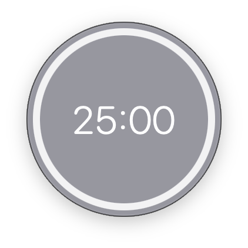

# Pomodoro

A tiny floating pomodoro timer for macOS: a borderless, see-through circle that stays on top of your other windows and on every Space.

## Screenshot

## Features

- **Always on top**: a 165-point circle that floats over everything, including full-screen apps. Drag it anywhere.
- **Progress ring**: the white ring shrinks as time runs out.
- **Colour shows the state**: grey when paused, pink while running, blue while you type a new time, light grey when it hits zero (with a beep).
- **Keyboard only**:
  - `Space` starts or pauses
  - type digits to set a time (`5` is 0:05, `130` is 1:30, `2500` is 25:00), then `Return` to start or `Esc` to cancel
  - `Delete` removes the last digit
  - `R` resets to the last time you set

## Getting started

Open `pomodoro.xcodeproj` in Xcode and press Run. Requires macOS 15.1 or later.

## How it's built

SwiftUI inside a custom borderless `NSWindow` (floating level, clear background). `PomodoroTimer` is an `ObservableObject` driven by a one-second `Timer`.
